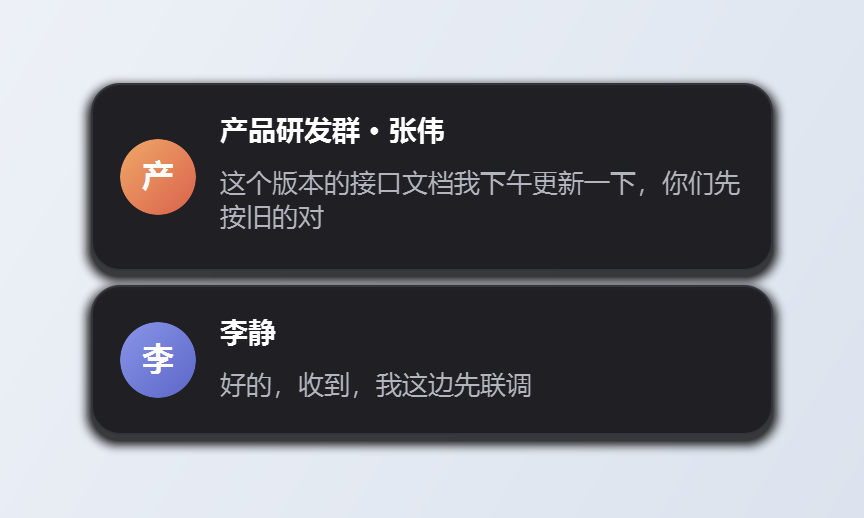
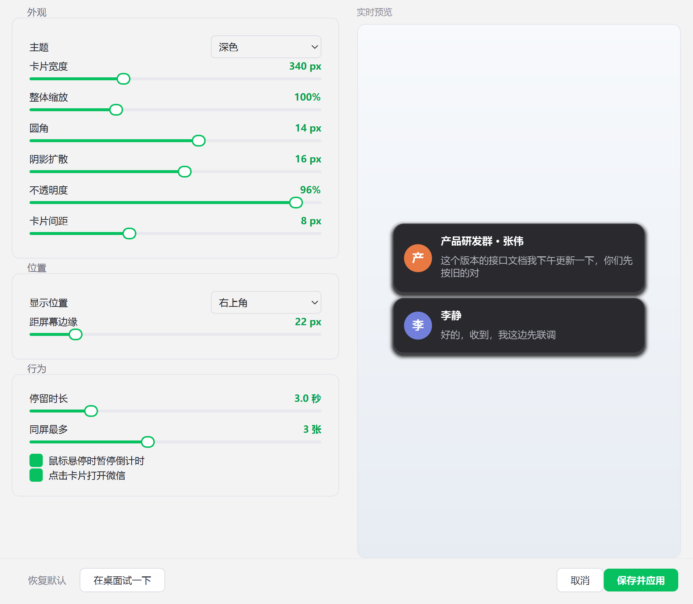

# DesktopToast · Windows 通知悬浮卡片

[](https://github.com/PepsiColaya/desktop-toast/releases/latest)
[](LICENSE)
[](https://github.com/PepsiColaya/desktop-toast)

> 让一闪而过的 Windows 通知，停在你能看见的地方。

> **第三方声明**：本项目为个人作品，与腾讯公司及其他软件厂商均无关联，未获其授权或认可。文中出现的软件名称只用于说明兼容性与适用场景，不构成任何官方关联。程序只读取 Windows 通知中心，不修改、不注入任何客户端。图标为原创设计（靛蓝卡片造型）。

> **关于改名**：项目原名 `WeChatToast`，早期只面向微信。现在它读的是整个 Windows 通知中心，
> 适用范围不再局限于某一个软件，因此统一改为 `DesktopToast`。
> 老用户升级时，`%APPDATA%\WeChatToast` 会在首次启动时自动搬到 `%APPDATA%\DesktopToast`，配置和日志都不用重设；
> 旧的开机自启项也会被自动清理。新旧版本的单实例名不同，理论上可以同时运行（不建议）。




Windows 的通知只在屏幕角落闪一下，随后沉进通知中心的历史里；而你真正需要它的时刻，往往正是眼睛不在屏幕上的时候。

DesktopToast 只做一件小事：**把 Windows 通知中心里的新通知，变成一张停得住的悬浮卡片**。谁发的、哪个会话、说了什么，一眼看完，几秒后自动淡出；鼠标移上去会暂停倒计时，想看多久看多久。

判断标准只有一条：**这个软件会不会把消息推给 Windows 通知中心**。会推的装上就能用——企业微信、QQ NT、钉钉、飞书、Outlook、Slack、Telegram，以及大量走系统通知的桌面程序和 UWP 应用。

也有反例。**微信 PC 版是最典型的一个：它一条系统通知都不发**，通知中心里根本找不到它，只能绕道手机转发。这类情况怎么处理，见 [案例：微信](#案例微信)。

## 特性

- **悬浮卡片**：圆角 + 柔和阴影，显示「会话名 · 发送者」和消息正文（两行内，超出省略）
- **真实头像**：把头像图片按「会话名.png」放进 `avatars/` 目录即可自动显示，未匹配的用渐变首字兜底
- **自动消失**：默认 3 秒淡出，鼠标移上去暂停倒计时，移开继续
- **多条堆叠**：同时来多条会依次排列，超出同屏上限的自动排队
- **同会话合并**：同一会话连着来消息时原地更新那张卡片并显示条数（如「产品研发群 · 张伟（3）」），不会被同一个群刷屏
- **多应用监听**：设置里列出的是「Windows 设置 → 系统 → 通知」中真正发过通知的应用，自动显示中文名，勾谁就提醒谁
- **转发来源自动识别**：本机装了「手机连接」并在转发手机通知时，程序会自动认出来，并内置一份本地 HTML 配置教程，一键打开照着做
- **中文名自动补全**：注册表里查不到名字的应用，等它发过一条通知，程序会从系统显示名学到中文并记住，下次打开就是中文
- **简略模式**：可以关掉正文，卡片只显示「谁找的你 + 有一条新消息」，旁边有人也不怕
- **点击跳转**：点卡片把微信唤到前台（目前只实现了微信，其它应用点了没反应）
- **多屏跟随**：默认在鼠标所在的那块屏幕弹出，也可以固定到主屏
- **免打扰名单**：不想被某几个群打扰时，在设置里把它们加进去即可，改完即时生效
- **开机自启**：设置里勾一下即可，写当前用户的启动项，不需要管理员权限
- **可视化调参**：内置设置面板，左侧拖滑块，右侧实时预览，所见即所得
- **配置永久保存**：改完自动落盘到 `%APPDATA%\DesktopToast\config.json`，重启、换 exe 位置都不会丢
- **深色 / 浅色主题**，宽度、缩放、圆角、阴影、透明度、位置、时长全部可调
- **托盘常驻**：支持暂停监听、单实例保护
- **日志可查**：运行日志写在配置目录下，托盘菜单「查看日志」一键打开，出问题能直接定位



## 工作原理

一句话：**不读任何软件的界面，也不碰它们的数据库，只读 Windows 通知中心。**

程序通过系统的 `UserNotificationListener` 订阅通知中心，一有新通知就取出文本、拼成卡片。
不注入目标进程、不读内存、不解密聊天记录，所以目标软件升级也不容易失效。

所有「会推系统通知」的软件共用同一条通路，文本结构大体规整：

| 行 | 含义 | 示例 |
|---|---|---|
| `text[0]` | 应用名 / 标题 | `企业微信` |
| `text[1]` | 会话名 | `产品研发群` |
| `text[2]` | 发送者 + 正文 | `张伟 : 这个版本的接口文档我下午更新一下` |

### 怎么判断通知是哪个应用发的

不能靠第一行猜——不同应用的第一行含义不一样（有的是应用名，有的是通知标题）。
所以优先读通知自带的 `app_info`：

| 字段 | 示例 | 用途 |
|---|---|---|
| `app_user_model_id` | `WorkBuddy.WorkBuddyAI` | 应用的唯一标识，最可靠 |
| `display_info.display_name` | `WorkBuddy AI` | 给人看的名字 |

设置面板里勾选的每个应用，会存下一组小写匹配串（显示名 + AUMID），
收到通知时拿 AUMID 和显示名去匹配，命中才弹卡片。

**关键点：只匹配应用标识，不匹配消息正文。** 否则一条正文里提到某个软件名的消息，
就会被误判成那个软件发来的。

代价是：有些应用拿不到 `app_info`（老式 Win32 程序、部分 UWP），
这种情况会退回「看首行」的兜底规则，识别范围很有限。

还有一个例外：**「手机连接」转发过来的通知，AUMID 和显示名全都一样**，
只能靠首行区分来源。这类通知的处理方式见 [案例：微信](#案例微信) 的第三节。

## 案例：微信

微信是这类问题里最典型的样本：**软件本身不配合，只能换条路走**。
如果你的软件会正常推系统通知，这一节可以直接跳过，去看 [环境要求](#环境要求)。

PC 微信 4.x 一条系统通知都不发，通知中心里没有它，本程序自然也无从读起。
下面把踩过的坑和最后的解法完整记下来——遇到别的「不推通知」的软件，排查思路是一样的。

### 一、为什么它进不了通知中心

不是配置问题，也不是权限问题，是**微信本身不提供这个能力**。四条可能的入口逐条实测：

| 入口 | 实测结果 | 结论 |
|---|---|---|
| Windows 通知中心（Toast） | 系统通知库 `wpndatabase.db` 里共 165 个应用处理器，**微信相关 0 个** | 微信从未注册过通知处理器，一条 Toast 都没推过 |
| UI Automation（读控件树） | 根窗口 → 1 个 `MMUIRenderSubWindowHW` 面板 → **0 个子控件** | 界面上根本没有「控件」这个概念 |
| 截屏主窗口 + 检测未读红点 | 窗口可见时能抓到（含 1779 个红色像素）；**最小化/隐藏后抓出来全是黑的** | 只在微信开着且在前台时有效，等于没用 |
| 自绘弹窗（盯窗口 + OCR） | 微信预建了 2 个 176×199 隐藏窗口（位置 872,409），疑似弹窗本体 | 待实测 |

**为什么 UIA 读不到**：微信 4.x 的界面是自绘引擎渲染的——所有内容画在同一块
`MMUIRenderSubWindowHW` 画布上（880×640 的单个 HWND）。
界面上不存在「按钮」「列表项」这种控件对象，所以无障碍接口**无从暴露**，
不是腾讯把接口关掉了、也不是我们没找对姿势。
主程序 `Weixin.dll` 里也确实搜不到 `UiaRootObjectId` / `qwindowsuiautomation` / `QT_ACCESSIBILITY`。

**为什么截图也不行**：

| 窗口状态 | 抓图尺寸 | 结果 |
|---|---|---|
| 可见 | 896×648 | 正常，含未读红点 |
| 最小化到任务栏 | 160×28 | 全黑 |
| 关到托盘（隐藏） | 160×28 | 全黑 |

而「需要提醒」的场景恰恰是微信不在前台的时候。所以截主窗口这条路走不通。
微信的设置里也没有「使用系统通知」这类开关（4.1.15.13 的「通知」页只有两个声音开关）。

### 二、绕道方案：手机连接转发

**这是目前唯一能稳定拿到微信原文的路子，本项目默认就按这个方式工作。**

原理很直接：

```
手机微信收到消息
   ↓ 手机系统通知
「连接至 Windows」把通知实时推给电脑
   ↓
Windows 通知中心生成一条 Toast，首行是「微信」
   ↓
本程序读这条 Toast → 弹卡片
```

电脑上不用装微信，也不要求手机和电脑在同一个局域网。手机连着网、和电脑保持配对即可。

转发过来的通知结构和自己推通知的应用一模一样，只是 `text[0]` 变成了**手机上那个 App 的名字**：

| 行 | 含义 | 示例 |
|---|---|---|
| `text[0]` | 手机上的应用名 | `微信` |
| `text[1]` | 会话名 / 发送者 | `妈妈` |
| `text[2]` | 正文 | `对` |

**配置步骤（iPhone）**

1. **电脑装「手机连接」**
   Windows 11 一般自带，开始菜单搜「手机连接」；没有的话去 Microsoft Store 装
   （Win10 上这个应用叫「你的手机」）。

2. **手机装「连接至 Windows」**
   App Store 搜「连接至 Windows」，微软官方出品，免费。

3. **配对**
   电脑打开「手机连接」→ 选 iPhone → 屏幕出现二维码 → 用手机上的
   「连接至 Windows」扫码。

4. **手机授权通知访问** ← 最容易漏的一步
   扫码后手机会弹「是否允许访问通知」，必须点**允许**。
   这一步拒绝了，后面全白搭，一条通知都转发不过来。
   事后想补开：iPhone 设置 → 连接至 Windows → 通知 → 允许。

5. **电脑端打开转发开关**
   「手机连接」→ 设置（齿轮）→ 找到「在电脑上接收通知」并打开。

6. **验证**
   手机锁屏，让别人给你发一条微信。电脑右下角应该弹出
   「微信（通过 手机连接）」的系统通知。

7. **确认系统层面没关掉**
   Windows 设置 → 系统 → 通知 → 在应用列表里找到「手机连接」→ 确认是「开」。
   这里关了的话，本程序同样读不到。

**Android 的差别**：流程一样，安卓版功能更全（能回消息、看照片）。
通知转发的开关在「连接至 Windows」App 里，位置和 iPhone 略有不同，
一般叫「通知」或「接收通知」。

**如果还是收不到**，按顺序排查：

1. 手机锁屏后给自己发条消息，看电脑有没有**系统**通知（不是本程序的卡片）。
   没有 → 问题在手机连接，先把它修好，跟本程序无关。
2. 有系统通知但本程序不弹 → 看托盘菜单的「查看日志」，确认有没有收到、有没有被应用过滤挡掉。
3. 设置面板里「手机连接」这一项是不是没勾；勾了的话，再看它下面「微信」子项有没有勾上。

### 三、转发过来的通知，怎么区分是哪个 App

「手机连接」把手机上的所有通知转发到电脑时，**它们共用同一个 AUMID 和显示名**：

```
AUMID   : Microsoft.YourPhone_8wekyb3d8bbwe!App
显示名  : 手机连接
```

微信、快捷指令、TestFlight、彩云天气、各种 App 的通知，这两个字段完全一样。
光看应用标识分不出是谁，**真实来源只写在通知首行**：

| 首行 `text[0]` | 二行 | 三行 |
|---|---|---|
| `微信` | `妈妈` | `对` |
| `快捷指令` | `17:47，每天` | `正在运行你的自动化操作` |
| `彩云天气Pro` | `预警订阅 · 河北省大风蓝色预警` | `预计20日傍晚到21日白天…` |
| `昆仑智联（私有化版）` | `王同华` | `项目编号80020改完以后给我说下哈` |

所以本程序对这类通知做了特殊处理：一旦发现来源是手机连接，就把**首行**也纳入应用匹配。
首行是应用名或标题、不是正文，不会出现「正文里提到某个 App 就被当成那个 App」的误判。

效果是：在「手机连接」下面只勾「微信」，微信的通知会弹，快捷指令和天气不会。

手机连接是所有手机 App 共用的入口，勾上它本身等于全收；想只留微信，
就展开它、把不要的子项取消勾选（对应配置项 `phone_apps`，见 [配置项](#配置项)）。

### 四、其它试过但没走通的路

- **盯微信的自绘弹窗 + OCR**：微信在后台收到消息时会自己弹一个小窗口（那两个 176×199
  的隐藏窗口很可能就是它）。可以监听「微信显示了一个小窗口」，再截图 OCR。
  硬伤：微信不弹窗时什么都拿不到，OCR 对彩色群名和表情的准确率只有七八成。
  `tools/diagnose.py --watch` 就是用来验证这条路的。
- **换一个会推系统通知的 IM**：企业微信、QQ NT、钉钉、飞书在 Windows 上都走通知中心，
  本程序开箱可用，不用折腾手机。**这也是遇到「不推通知」的软件时最省事的替代方案。**
- **解密微信本地消息库**：技术上可行（`db_storage\message\*.db` 是 SQLCipher 加密，
  密钥在进程内存里），但要读别的进程内存，会被杀软和微信风控盯上，升级即失效。
  **本项目不提供这个能力。**

> 这三条路的取舍可以推广：遇到任何「不推系统通知」的软件，先看它有没有替代品会推通知，
> 其次看它有没有云端/手机端能转发，最后才是本地逆向——而本地逆向通常意味着和官方风控赛跑。

## 先确认你的软件能不能用

三步，都不用装任何东西：

1. 让那个软件发一条消息，看屏幕右下角有没有弹出 **Windows 系统通知**
2. 有 → 打开「设置 → 系统 → 通知」，在应用列表里能找到它 → 装上本程序就能用
3. 没有 → 它属于「不推系统通知」那一类，得绕道，思路见 [案例：微信](#案例微信)

拿不准的话，跑一次 `tools/diagnose.py`，它会把这套检查自动做完并给出结论。

## 环境要求

- Windows 10 1809+ 或 Windows 11
- 目标应用会往 Windows 通知中心推消息（企业微信 / QQ NT / 钉钉 / 飞书 / Outlook 等）
- 想接微信这类「不推系统通知」的应用，得先配好「手机连接」，见 [案例：微信](#案例微信)
- Python 3.10+（仅源码运行需要）

## 使用

### 方式一：直接跑 exe

从 [Releases](https://github.com/PepsiColaya/desktop-toast/releases/latest) 下载 `DesktopToast.exe` 双击运行。托盘出现靛蓝色的卡片图标就是启动成功了，**没有主窗口是正常的**。

首次启动单文件 exe 需要解压，会等 3～8 秒。

### 方式二：源码运行

```bash
git clone https://github.com/PepsiColaya/desktop-toast.git
cd desktop-toast
python -m venv .venv
.venv\Scripts\activate
pip install -r requirements.txt
python main.py
```

或者双击 `run.bat`（用的是系统 Python，需要先 `pip install -r requirements.txt`）。

> **装不上依赖时**：如果报 `Could not find a version that satisfies the requirement PySide6-Essentials`，
> 说明当前 pip 镜像源缺包，加 `-i https://pypi.org/simple` 换成官方源再装即可：
> `pip install -i https://pypi.org/simple -r requirements.txt`

> 想跑 `tools/` 下的诊断脚本，再装开发依赖：`pip install -r requirements-dev.txt`
> （多了 uiautomation、Pillow 和 OCR 相关的 winrt 包，打 exe 用不到）

### 打开设置

右键托盘图标 → **设置…**（双击托盘图标也可以）。

**改完不用点保存**——停手半秒后自动写入配置并即时生效，面板底部会闪一下「已自动保存」。直接关窗口也不会丢，关闭前会再存一次。

面板里能改的：

| 分组 | 内容 |
|---|---|
| 外观 | 主题、卡片宽度、整体缩放、圆角、阴影扩散、不透明度、卡片间距 |
| 监听应用 | 来自系统「设置 → 系统 → 通知」里发过通知的应用，勾选哪些就提醒哪些（默认只勾手机连接）；展开「手机连接」还能只挑想收的手机 App |
| 位置 | 显示位置（四角）、显示屏幕（跟随鼠标 / 主屏）、距屏幕边缘 |
| 行为 | 停留时长、同屏最多几张、悬停暂停、点击唤起微信、同会话合并、卡片显示正文、开机自启 |
| 免打扰 | 输入会话名回车即可加入，该会话来消息不再弹卡片 |
| 头像 | 头像目录位置，一键打开 |

「在桌面试一下」会用当前参数弹一条真实卡片，方便确认实际效果。

监听应用、免打扰、开机自启、显示屏幕、显示正文这几项改完都是**即时生效**，不需要重启程序。

## 日志

运行日志写在配置目录下的 `desktop-toast.log`（超过 512 KB 自动滚动，最多保留 3 份）：

| 运行方式 | 位置 |
|---|---|
| exe | `%APPDATA%\DesktopToast\desktop-toast.log` |
| 源码 | 项目根目录 `desktop-toast.log` |

托盘菜单 → **查看日志** 会直接打开所在目录。反馈问题时带上这个文件即可。

## 前提条件

1. **Windows** → 设置 → 隐私和安全性 → 通知 → 允许应用访问你的通知（必须打开）
2. **目标应用** → 必须会往 Windows 通知中心推消息（必须满足，否则收不到）

程序启动时会检查通知访问权限，没授权会弹提示。

第 2 条是硬门槛。企业微信 / QQ NT / 钉钉 / 飞书 / Outlook 都满足；
**微信 PC 版不满足**，得靠「手机连接」把手机上的通知转发过来才算满足
（[步骤](#案例微信)）。不确定某个应用满不满足，就跑 `tools/diagnose.py` 看第 4 节。

## 配置项

配置自动保存在：

| 运行方式 | 位置 |
|---|---|
| exe | `%APPDATA%\DesktopToast\config.json` |
| 源码 | 项目根目录 `config.json` |

放在 `%APPDATA%` 的好处是：exe 被移动、复制、重新下载覆盖，配置都还在。旧版本留在 exe 同目录的 `config.json` 会在首次启动时自动迁移过来。

设置面板覆盖了常用项，其余可直接改 `config.json`（改完重启程序生效）：

| 键 | 默认值 | 说明 |
|---|---|---|
| `theme` | `dark` | 主题，`dark` / `light` |
| `card_width` | `340` | 卡片宽度（px），240–560 |
| `scale` | `1.0` | 字号与内边距整体缩放，0.8–1.5 |
| `radius` | `14` | 圆角（px），0–24 |
| `shadow` | `16` | 阴影扩散范围（px），0–30 |
| `opacity` | `0.96` | 背景不透明度，0.4–1.0（文字始终不透明） |
| `gap` | `8` | 卡片间距（px），0–24 |
| `position` | `top-right` | 位置：`top-right` / `top-left` / `bottom-right` / `bottom-left` |
| `screen` | `cursor` | 显示在哪块屏幕：`cursor` 跟随鼠标 / `primary` 主屏 |
| `margin` | `22` | 距屏幕边缘（px） |
| `duration_ms` | `3000` | 停留时长（毫秒） |
| `max_visible` | `3` | 同屏最多几张 |
| `fade_in_ms` / `fade_out_ms` | `170` / `280` | 淡入淡出时长 |
| `hover_pause` | `true` | 鼠标悬停时暂停倒计时 |
| `click_to_open_wechat` | `true` | 点击卡片唤起微信（键名沿用旧版，目前只支持微信） |
| `merge_same_source` | `true` | 同一会话连续消息合并成一张卡片并显示条数 |
| `show_content` | `true` | 卡片是否显示消息正文；`false` 时只显示「有一条新消息」 |
| `poll_interval_ms` | `1000` | 通知轮询间隔 |
| `ignore_sources` | `[]` | 不提醒的会话名，如 `["某工作群"]` |
| `enabled_apps` | 手机连接 | 只提醒这些应用的通知，见下方说明 |
| `phone_apps` | `null` | 「手机连接」下面勾了哪些手机 App；`null` 表示全收，`[]` 表示全不收 |
| `autostart` | `false` | 开机自启（对应 HKCU 启动项） |
| `avatar_dir` | 配置目录下 `avatars` | 头像图片目录 |

`enabled_apps` 的结构如下。`match` 是一组小写子串，收到通知时拿 AUMID 和显示名去包含匹配；
空数组表示**什么都不弹**：

```json
"enabled_apps": [
  {"key": "microsoft.yourphone_8wekyb3d8bbwe!app", "name": "手机连接",
   "aumid": "Microsoft.YourPhone_8wekyb3d8bbwe!App",
   "match": ["microsoft.yourphone", "手机连接"]}
]
```

`aumid` 是可选字段，填了会一并加入匹配串，让设置面板勾选时能和注册表里的原始标识对上。

默认只有「手机连接」这一条，它代表「手机上转发过来的通知」这个入口。
微信正是靠它进来的——PC 微信自己不往消息中心发通知，系统通知列表里也没有它，
把它写进名单只会让人以为勾了就能收。

手机连接把所有手机通知都收进同一个 AUMID，光看应用标识分不出是微信还是别的 App。
所以「监听应用」里它下面挂了子项，勾哪个就收哪个：

```json
"phone_apps": ["微信", "QQ"]     // 只收手机上的微信和 QQ
"phone_apps": null               // 全收（默认，也是老配置升级后的行为）
"phone_apps": []                 // 全不收
```

判定靠通知首行的 App 名。认不出来的（新装的手机 App、名字和注册表里对不上）一律放行，
宁可多弹一条，也不会因为对不上名字把消息吃掉。

子项按名字存，所以手机上改了 App 的显示名，这里要重新勾一次。

数值超出范围会自动夹紧到合法区间。

### 监听应用的中文名是怎么来的

设置面板「监听应用」列出的名单来自注册表
`HKCU\Software\Microsoft\Windows\CurrentVersion\Notifications\Settings`，
也就是 Windows「设置 → 系统 → 通知」里出现过通知的应用。不推通知的软件
（比如 PC 微信）本来就不会出现在这个名单里，看不到它是正常的。

名字按四级解析，越靠前越准：

1. **学习缓存** `app_names` —— 程序运行时从通知的 `app_info.display_name` 拿到，
   是系统本地化过的名字，学到就写回配置
2. **注册表** `AppUserModelId\<AUMID>\DisplayName` —— 少数软件会写
3. **内置映射** —— 常见软件的中文名（`apps.py` 里的 `KNOWN_NAMES`）
4. **兜底美化** —— 把 `Company.Product_8wekyb3d8bbwe!App` 拆成可读英文

匹配串拿的是 **AUMID** 而不是显示名拆词。显示名拆词会产生「microsoft」这种通用词，
勾一个 Microsoft Store 就会把 OneDrive、闹钟、截图工具的通知全放进来。

### 手机连接检测

设置面板的「手机连接」一栏会自动识别三种状态：

| 状态 | 含义 |
|---|---|
| 未检测到 | 本机没装「手机连接」 |
| 已安装但未转发 | 装了，但没配对成功或没打开通知转发开关 |
| 工作正常 | 已经在转发手机 App 的通知，并列出正在转发哪些 App |

点「查看连接配置教程」会在配置目录生成一份自包含的
`手机连接配置教程.html`（不依赖网络）并用默认浏览器打开，内容按检测到的状态
给出针对性的下一步。

## 头像

通知本身**不带头像**（微信 4.x 如此，多数应用也一样），本地头像缓存又是哈希命名、无法对应到会话名，所以程序不会自动抓取头像。

替代方案是「按名字匹配」：把头像图片命名成会话名，放进头像目录即可（默认 `%APPDATA%\DesktopToast\avatars`，设置面板里点「打开目录」可直接跳过去）。

```
avatars/
├── 产品研发群.png
├── 李静.jpg
└── 家里群.webp
```

- 支持 `png / jpg / jpeg / webp / bmp`
- 会话名要和通知里显示的**完全一致**（微信里就是群名或备注名），包括空格和表情符号
- 建议裁成正方形、200×200 以上，程序会自动圆角裁剪
- 文件名里的 `\ / : * ? " < > |` 会被替换成 `_`
- 没匹配到的会话自动用渐变首字占位，不影响使用
- 新增或替换图片后不用重启，下一张卡片自动生效

设置面板里点「打开目录」可以直接跳过去。

## 项目结构

```
desktop-toast/
├── main.py              # 入口：托盘、单实例、信号桥接
├── config.py            # 配置默认值、读写、范围校验、自动迁移
├── logger.py            # 日志：文件 + 控制台，含全局异常钩子
├── autostart.py         # 开机自启（HKCU Run 项）
├── apps.py              # 从注册表枚举通知应用 + 中文名解析 + 手机连接检测
├── guide.py             # 生成手机连接配置教程（本地 HTML）
├── logo.py              # 应用图标绘制（托盘/窗口/exe 共用）
├── watcher.py           # 读通知中心、解析通知文本、学习应用中文名
├── toast.py             # 悬浮卡片绘制与堆叠管理
├── settings_window.py   # 可视化设置面板（自动保存）
├── wechat.py            # 唤起微信主窗口（点击卡片时用）
├── render_preview.py    # 渲染展示图（开发用）
├── config.json          # 源码运行时的配置（首次运行自动生成）
├── requirements.txt
├── requirements-dev.txt # tools/ 下诊断脚本的额外依赖
├── build.bat            # 一键打包 exe
├── run.bat              # 源码方式启动
├── avatars/             # 头像图片（按会话名命名）
├── docs/                # 截图
└── tools/               # 开发期探测脚本 + 回归测试（可忽略）
```

## 打包

```bash
build.bat
```

脚本会自动装依赖再调 PyInstaller，产物在 `dist/DesktopToast.exe`，约 40 MB（PySide6 占大头）。
打包只用 `requirements.txt`，`requirements-dev.txt` 里的诊断依赖不会进 exe。

用户端的配置和日志都在 `%APPDATA%\DesktopToast\` 下，exe 可以随便移动、复制、重新下载。

## 已知限制

- **只支持走 Windows 通知中心的应用**。有些程序自己有独立的消息窗口（比如部分游戏客户端、
  自绘 UI 的工具），根本不往系统通知中心推消息，勾了也收不到
- **微信 PC 版属于上一条**，必须靠「手机连接」转发（[步骤](#案例微信)）。
  手机没连上、锁屏时没授权通知、或手机连接被系统杀掉，都会收不到
- 手机连接转发过来的所有 App 共用一个 AUMID，只能靠通知首行区分来源；
  首行和应用名对不上的应用可能筛不出来
- **只读通知**，拿不到历史消息，也不能在卡片里直接回复
- 点击卡片只能把微信唤到主窗口，**无法定位到具体某个会话**（微信 4.x 自绘，外部点不进去）；
  其它应用的点击跳转还没实现
- 图片 / 表情 / 语音消息在通知里没有正文，卡片会显示「（新消息）」
- 应用本身会合并同一会话的连续消息，此时可能只弹一次
- 你正开着那个应用、且正看着那个会话时，它不发通知，所以不会弹卡片——这是符合预期的
- 个别应用拿不到 `app_info`，无法识别应用标识，只能靠「看首行」的兜底规则识别
- 监听应用列表来自注册表里「发过通知的应用」，**刚装好、还没发过一条通知的应用不会出现**；
  点「刷新」也找不到的话，先让那个应用发一条通知再来
- 注册表里查不到中文名的应用会先显示美化后的英文，等它真的发过通知就会自动换成中文

## 技术备注

`tools/` 下是开发时用来确认可行性的脚本：

| 脚本 | 用途 |
|---|---|
| `diagnose.py` | 一次性体检：通知权限、通知中心现状、目标应用窗口、历史推送记录、UIA 树，并给出小结 |
| `diagnose.py --watch 60` | 盯 60 秒，实时打印新系统通知 / 目标应用新建的窗口，并自动截图 OCR |
| `grab_window.py` | 把目标应用的任意窗口（含隐藏窗口）抓成 PNG，用来判断它是什么 |
| `probe_windows.py` | 枚举目标应用的顶层窗口，看窗口类和标题 |
| `dump_uia.py` | 导出目标应用主窗口的 UIA 控件树（微信 4.x 的结论：空的） |
| `test_notify.py` | 验证通知访问权限与 Toast 的文本结构 |

排查「收不到消息」时，先跑 `diagnose.py`：

```bash
.venv\Scripts\python.exe tools\diagnose.py
```

它会直接告诉你三条入口哪条通、哪条不通。

想给一个新应用做适配，也建议先跑这个脚本确认它的通知结构。

回归测试（不需要任何 IM 软件、不弹窗，纯逻辑校验）：

```bash
python tools/smoke_test.py
```

覆盖消息解析（含正文里带中文冒号的误判）、折行（英文不拆词）、配置规范化、同会话合并计数。
改完代码跑一遍，全绿再提交。

## License

[MIT](LICENSE)
